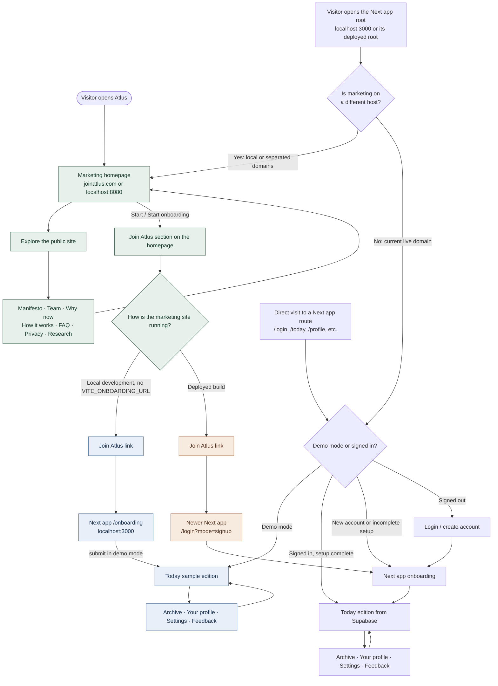

# Atlus website flow

This diagram follows the prepared local code. Paste this file into Codex and ask it to render the Mermaid diagram as an interactive flowchart, with the **local demo**, **prepared production journey**, and **currently live domain** shown separately.

## What this means

- **The local first page is the marketing homepage.** Open `http://localhost:8080`. The Next app's bare root (`http://localhost:3000/`) now redirects there. A deployed Next app redirects to `https://joinatlus.com` (or `ATLUS_MARKETING_URL`) only when marketing is hosted on a different host.
- **The live public domain is not marketing yet.** On 20 October 2026, opening `https://joinatlus.com/` reached the Next app's `/login` screen. `app.joinatlus.com` did not resolve in the browser. The root redirect intentionally avoids sending the live domain back to itself. Making marketing the live first page requires deploying it at `joinatlus.com` and putting the product app on a separate host. The domain uses `dns1.p05.nsone.net` through `dns4.p05.nsone.net` name servers, consistent with Netlify-managed DNS; the Netlify account is not connected in this workspace.
- **The local Join button opens the newer Next app.** With the default development configuration it links to `http://localhost:3000/onboarding`. Demo submission leads to a sample Today edition. Demo changes are not saved.
- **The prepared deployed Join link uses the newer product.** It opens `https://app.joinatlus.com/login?mode=signup` by default (or the `VITE_APP_URL` host). Account creation then leads into Next app onboarding and its Supabase-backed Today edition. The former email handoff to the Express prototype has been removed from the prepared marketing code. This path cannot work live until the product app is available on its own host.
- **The Next app has its own account journey.** A direct visit to its `/login` or `/today` routes follows Supabase authentication and the newer onboarding flow when demo mode is off. The marketing site's deployed form is not currently wired to that journey.

## Source files

- Marketing entry, Join link and production email handoff: `marketing-site/src/routes/index.tsx`
- Public navigation: `marketing-site/src/components/atlus/SiteChrome.tsx`
- Next app root redirect: `atlus-mvp/app/page.tsx`
- Next app account routing: `atlus-mvp/app/login/actions.ts`, `atlus-mvp/lib/auth.ts`, `atlus-mvp/components/NavLinks.tsx`
- Older onboarding API and UI: `backend/src/app.ts`, `frontend/onboarding-prototype.html`
